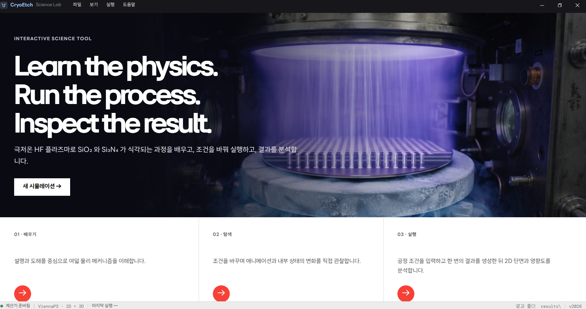
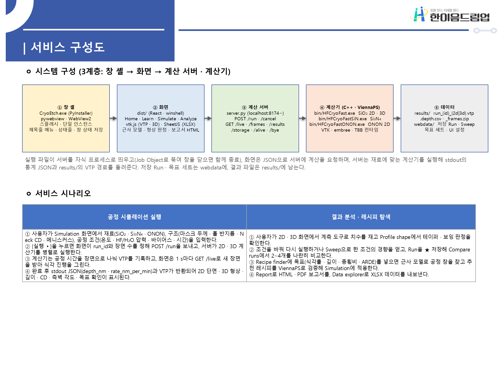
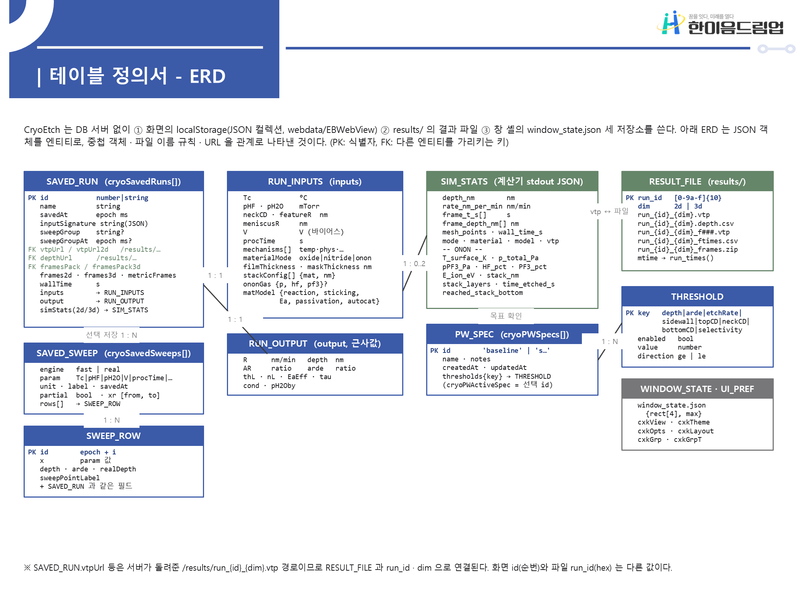

# CryoEtch Science Lab

**반도체 극저온 플라즈마 식각 시뮬레이터**  
2026년 한이음 드림업 · **TeamSemi**

---

## 💡1. 프로젝트 개요

### 1-1. 프로젝트 소개

- **프로젝트명:** 반도체 극저온 플라즈마 식각 시뮬레이터
- **서비스명:** CryoEtch Science Lab
- **프로젝트 정의:** 극저온 HF 플라즈마 식각의 물리·화학 메커니즘을 학습하고, 공정 조건에 따른 식각률과 형상 변화를 계산·분석하는 시뮬레이터



CryoEtch는 **이론 학습 → 조건 실험 → 결과 분석**을 하나의 환경에서 수행할 수 있도록 만든 반도체 공정 학습·분석 도구입니다. 온도 의존성, 물리흡착, BET 다층 흡착, 표면 확산, 모세관 응축, HF–H₂O 자가촉매 반응의 여섯 메커니즘을 개별적으로 켜고 끄며 식각 결과에 미치는 영향을 살펴볼 수 있습니다.

브라우저에서 동작하는 빠른 근사 모델로 공정 조건을 탐색하고, **ViennaPS 기반 물리 엔진**으로 식각 프로파일을 계산합니다. 최종 실행본은 **산화막(SiO₂), 질화막(Si₃N₄), ONON 적층 구조**를 지원하며, 웹 기술로 구현한 화면을 Windows 데스크톱 프로그램에서 제공합니다.

### 1-2. 개발 배경 및 필요성

반도체 소자가 3D 적층 구조로 발전하면서 좁고 깊은 구조를 형성하는 고종횡비 식각의 중요성이 커지고 있습니다. 극저온 식각에서는 온도에 따른 반응성 변화와 흡착, 물질 수송, 응축이 동시에 작용하므로, 최종 식각률이나 형상만으로 각 현상의 영향을 파악하기 어렵습니다.

공정 조건을 반복적으로 바꾸어 실험하는 부담을 줄이려면 변수와 결과의 관계를 먼저 살펴볼 수 있는 도구가 필요합니다. CryoEtch는 메커니즘별 영향을 분리해 관찰하고, 공정 조건에 따른 깊이·종횡비·측벽 형상을 비교할 수 있도록 설계했습니다. 이를 통해 극저온 식각 원리의 이해와 실험 후보 조건의 탐색을 지원합니다.

### 1-3. 프로젝트 특장점

- **메커니즘별 비교:** 여섯 물리·화학 메커니즘을 개별 ON/OFF하여 식각률과 표면 상태 변화를 관찰합니다.
- **두 가지 계산 방식:** 빠른 근사 모델로 조건을 탐색하고, ViennaPS의 Level-Set 및 입자 수송 계산으로 식각 형상을 확인합니다.
- **학습과 분석의 연결:** 가이드 학습, 메커니즘 실험, 시뮬레이션, 결과 비교를 하나의 흐름으로 제공합니다.
- **재료별 모델:** 산화막·질화막 및 두 재료가 교대로 쌓인 ONON 구조를 선택해 계산할 수 있습니다.
- **형상과 수치의 동시 확인:** 프로파일, 깊이 이력, 식각률, 종횡비, 측벽각과 표면 상태를 함께 분석합니다.
- **결과의 근거 표시:** 문헌 근거, 모델 계산, 개념 표현을 구분하여 수치와 시각화의 의미를 설명합니다.
- **로컬 실행:** 실행 패키지를 풀면 Python을 별도로 설치하지 않고 프로그램을 사용할 수 있습니다.

### 1-4. 주요 기능

| 기능 | 설명 |
| --- | --- |
| 가이드 학습 | 극저온 식각의 배경과 여섯 메커니즘을 단계별 설명 및 애니메이션으로 학습 |
| 메커니즘 실험 | 온도 의존성·물리흡착·BET 다층 흡착·표면 확산·모세관 응축·자가촉매 반응의 영향을 비교 |
| 공정 시뮬레이션 | 재료, 온도, 압력, 가스 조건, 바이어스, 시간, 마스크와 홀 형상을 설정해 계산 |
| ONON 적층 식각 | 산화막·질화막 두께와 적층 쌍 수를 설정하고 재료별 단면 및 식각 진행을 확인 |
| 프로파일 분석 | 2D 단면과 지원 모드의 3D 형상을 확인하고 깊이·CD·종횡비·측벽각 등을 분석 |
| 시간 경과 및 표면 상태 | 식각 진행을 재생하고 흡착 피복률 등 계산된 표면 상태를 시각화 |
| Run 저장·비교 | 조건과 결과를 저장하고 여러 실행의 프로파일 및 수치를 비교 |
| 조건 탐색 | 파라미터 스윕과 목표 조건 탐색을 통해 공정 조건에 따른 결과 변화를 확인 |
| 결과 내보내기 | CSV·XLSX 등 수치 데이터, 형상 파일, 그래프 및 HTML·PDF 보고서를 생성 |

> ONON 적층 식각은 현재 **2D 계산**을 지원합니다. 메커니즘 실험에 사용하는 근사 모델과 ViennaPS의 형상 계산 결과는 구분해 표시합니다.

### 1-5. 기대 효과 및 활용 분야

**기대 효과**

- 실제 실험 전에 후보 공정 조건을 비교하여 반복 실험의 범위를 좁히는 데 활용합니다.
- 식각 결과에 영향을 주는 메커니즘을 관찰하여 원인 분석과 공정 이해를 돕습니다.
- 고가 장비 없이 조건 변경과 결과 분석을 반복할 수 있는 학습 환경을 제공합니다.
- 조건·결과 저장과 보고서 생성을 통해 실험 기록 및 팀 내 결과 공유를 지원합니다.

**활용 분야**

- 반도체 공정 및 극저온 플라즈마 식각 교육
- 산화막·질화막·ONON 적층 식각의 메커니즘 분석
- 3D NAND 등 고종횡비 구조와 관련된 공정 조건의 사전 탐색
- 연구·설계 단계의 가상 실험과 결과 비교

### 1-6. 기술 스택

| 구분 | 사용 기술 | 역할 |
| --- | --- | --- |
| 프론트엔드 | JavaScript/JSX, React, Vite | 학습·시뮬레이션·분석 화면과 브라우저 근사 모델 |
| 시각화 | vtk.js, Recharts | VTP 형상 렌더링 및 수치 그래프 |
| 데이터 내보내기 | SheetJS | Excel 파일 생성 |
| 로컬 계산 서버 | Python, `http.server.ThreadingHTTPServer`, `subprocess` | HTTP API, 계산기 실행, 결과 파일 제공 |
| 물리 엔진 | C++, ViennaPS, ViennaLS, ViennaRay, ViennaCS | 표면 반응, 입자 수송, Level-Set 형상 계산 |
| 계산·형상 라이브러리 | Embree, VTK, TBB | 레이트레이싱, 형상 처리, 병렬 계산 지원 |
| 데스크톱 실행 | PyInstaller, pywebview, WebView2 | Windows 실행 파일, 앱 창, 웹 화면 표시 |
| 데이터 저장 | localStorage, JSON, 로컬 결과 파일 | 저장한 Run·Sweep·설정 및 VTP·CSV 결과 관리 |
| 개발·빌드 | CMake, Visual Studio, VS Code, Node.js/npm, Git | 엔진·화면 빌드 및 소스 관리 |

---

## 💡2. 팀원 소개

**팀명: TeamSemi · 팀원 4명 · 멘토 1명**

| 구분 | 이름 | 담당 업무 |
| --- | --- | --- |
| 팀원 | **남상우** | 산화막 식각 모델링 |
| 팀원 | **이동혁** | 시뮬레이터 웹사이트 제작 |
| 팀원 | **강현진** | ON층 식각 프로파일 구현 |
| 팀원 | **심규선** | 질화막 식각 모델링 |
| 멘토 | **신영준** | 프로젝트 자문 |

---

## 💡3. 시스템 구성도

### 3-1. 서비스 구성도



*제작설계서 9쪽의 시스템 구성도입니다.*

1. **앱 실행:** `CryoEtch.exe`가 로컬 계산 서버를 시작하고 pywebview 창에 React 화면을 표시합니다.
2. **조건 설정:** 사용자가 재료·구조·공정 조건을 입력합니다. 화면의 근사 모델로 조건의 경향을 빠르게 확인할 수 있습니다.
3. **계산 요청:** 화면이 `POST /run`으로 JSON 입력을 전달하면 서버가 재료와 계산 모드에 맞는 C++ 계산기를 실행합니다.
4. **결과 분석:** 화면은 계산 통계와 VTP·CSV 등 결과 파일을 읽어 식각 형상, 깊이 이력 및 분석 지표를 표시합니다.
5. **저장·내보내기:** 선택한 Run과 설정을 저장하고, 결과를 비교하거나 데이터 및 보고서로 내보냅니다.

### 3-2. 엔티티 관계도



*제작설계서 62쪽의 실제 저장 구조를 나타낸 엔티티 관계도입니다.*

CryoEtch는 **localStorage의 JSON 데이터, `results/`의 결과 파일, `window_state.json`의 창 설정**을 저장소로 사용합니다. 위 관계도는 JSON 객체의 포함 관계와 결과 파일 참조를 설명하며, 별도의 관계형 데이터베이스 서버를 전제로 하지 않습니다.

| 주요 엔티티 | 저장·관리 내용 |
| --- | --- |
| `SAVED_RUN` | 실행 이름, 저장 시각, 입력·출력, 계산 통계 및 결과 파일 경로 |
| `RUN_INPUTS` | 온도·가스·시간·구조·재료·메커니즘 등의 계산 조건 |
| `RUN_OUTPUT` | 화면 근사 모델의 식각률·깊이·종횡비 등 결과 |
| `SIM_STATS` | 계산기가 반환한 깊이·식각률·계산 시간 등 통계 |
| `RESULT_FILE` | 실행 식별자와 계산 차원별 VTP·CSV·프레임 파일 |
| `SAVED_SWEEP`, `SWEEP_ROW` | 파라미터 스윕 조건과 각 지점의 결과 |
| `PW_SPEC`, `THRESHOLD` | 공정 목표와 지표별 판정 기준 |
| `WINDOW_STATE`, UI 설정 | 창 크기·위치, 화면 배치 및 표시 설정 |

---

## 💡4. 핵심 소스코드

### 4-1. 시간에 따른 식각 깊이 계산

브라우저의 빠른 근사 모델은 공정 시간을 여러 단계로 나눕니다. 매 단계에서 현재 깊이로 종횡비를 갱신하고 식각률을 다시 계산하여 깊이를 누적합니다. 이를 통해 구조가 깊어지면서 수송 조건이 달라지는 **ARDE(종횡비 의존 식각)**의 영향을 반영합니다.

아래는 제작설계서 80쪽의 `depthIntegrate` 발췌입니다. 배포 번들의 `fL` 함수에 대응하며, 설계서에서 복원한 코드를 읽기 쉬운 식별자로 정리한 형태입니다. `etchModel`은 같은 설계서의 근사 식각률 모델(`dL`)을 호출하므로 이 함수만으로 독립 실행되지는 않습니다.

```javascript
function depthIntegrate(
  T, pHF, pH2O, menR, featR, V, f, t = 600, steps = 60
) {
  const w = 2 * featR;
  const dt = t / steps;
  let d = 0;
  const pts = [{ t: 0, z: 0, R: 0, AR: 0 }];

  for (let i = 0; i < steps; i++) {
    const r = etchModel(
      T, pHF, pH2O, menR, Math.max(0.5, d / w), V, f
    ).R;

    d += (r / 60) * dt;
    pts.push({ t: (i + 1) * dt, z: d, R: r, AR: d / w });
  }

  return { pts, depth: d, AR: d / w };
}
```

- `w`: 홀 반지름 `featR`로부터 계산한 폭(nm)
- `dt`: 단계별 시간 간격(s)
- `r`: 해당 단계의 식각률(nm/min)
- `d`: 누적 식각 깊이(nm)
- `AR`: 깊이를 폭으로 나눈 종횡비
- `f`: 메커니즘 ON/OFF 상태

**이 코드는 빠른 조건 탐색에 사용하는 근사 모델입니다.** ViennaPS의 Level-Set 형상 계산은 아래의 별도 계산 경로에서 수행합니다.

### 4-2. 물리 엔진 연동

| 단계 | 구현 내용 |
| --- | --- |
| 입력 변환 | 화면의 온도·분압·형상 조건을 서버 입력 단위로 변환 |
| 계산 요청 | `POST /run`에 JSON 전달 |
| 엔진 실행 | Python 서버에서 재료와 모드에 맞는 `HFCryoFast` 계열 계산기 실행 |
| 형상 계산 | C++/ViennaPS에서 표면 반응과 수송을 반영해 식각 경계면 갱신 |
| 결과 반환 | 계산 통계와 VTP·CSV 등의 파일 경로 반환 |
| 결과 표시 | vtk.js 및 그래프로 프로파일과 수치를 표시 |

현재 실행 패키지의 프론트엔드 계산 로직은 `dist/assets/`의 빌드된 JavaScript 번들에 포함되어 있으며, C++ 계산기는 `bin/`에 실행 파일 형태로 포함되어 있습니다.

---

## 💡5. 실행 방법

1. Windows용 실행 패키지 ZIP을 내려받아 **전체 압축을 해제**합니다.
2. 폴더 안의 **`CryoEtch.exe`**를 실행합니다.
3. 처음 사용하는 경우 가이드 학습에서 메커니즘을 살펴보거나, Simulation 화면에서 재료와 공정 조건을 설정합니다.
4. **실행**을 누른 뒤 프로파일과 수치를 확인하고, 필요한 결과를 저장·비교·내보냅니다.

```text
CryoEtch/
├─ CryoEtch.exe        # 프로그램 실행
├─ _internal/         # 실행에 필요한 라이브러리
├─ bin/               # C++ 식각 계산기와 의존 라이브러리
├─ dist/              # 화면과 시각화 파일
├─ README.txt         # 실행 안내
└─ ONON_사용법.txt     # ONON 적층 식각 사용 안내
```

실행 패키지의 `_internal/`, `bin/`, `dist/`는 `CryoEtch.exe`와 함께 유지해야 합니다. `results/`, `webdata/`, 창 상태 및 로그 파일은 사용 중 생성됩니다.

Windows 11을 기본 실행 환경으로 안내하며, Windows 10에서 WebView2를 사용할 수 없는 경우에는 기본 브라우저로 화면이 열립니다. 실행 패키지에는 필요한 Python 실행 환경이 포함되어 있습니다.

